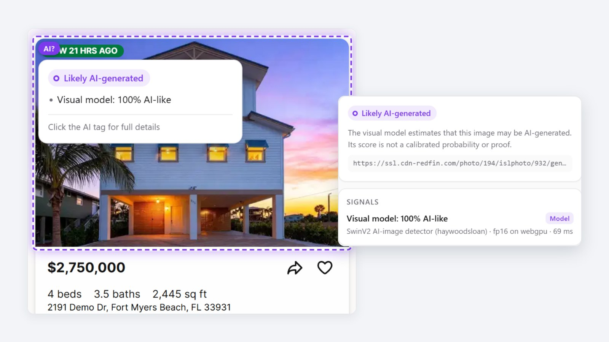
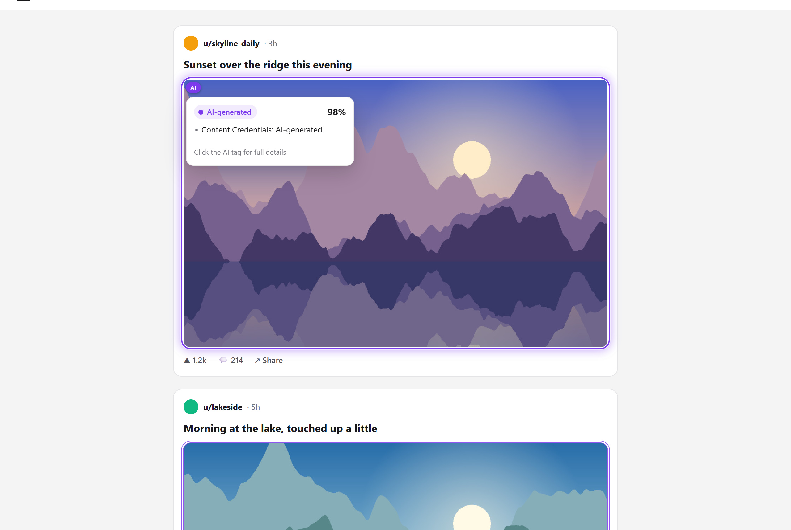
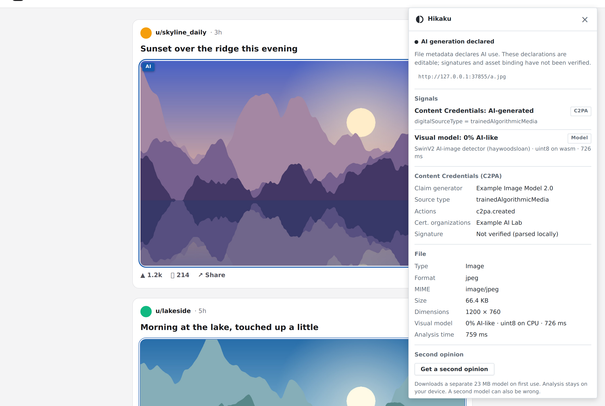
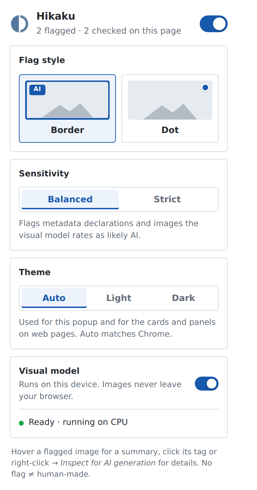

<p align="center">
  
</p>

<h1 align="center">Hikaku</h1>

<p align="center">
  <strong>Spot signs of AI. As you browse.</strong><br>
  A browser extension that quietly flags AI-generated images and video, and shows you why. Everything runs on your device.
</p>

<p align="center">
  <a href="https://hikaku.io">hikaku.io</a> ·
  <a href="https://github.com/hikaku-io/hikaku-extension/releases/latest">Download</a> ·
  <a href="docs/ARCHITECTURE.md">Architecture</a> ·
  <a href="docs/MODELS.md">Models</a> ·
  <a href="https://github.com/hikaku-io/hikaku-bench">Benchmark</a> ·
  <a href="CONTRIBUTING.md">Contributing</a>
</p>

<p align="center">
  <a href="https://github.com/hikaku-io/hikaku-extension/actions/workflows/ci.yml"></a>
  <a href="https://github.com/hikaku-io/hikaku-extension/releases/latest"></a>
  <a href="LICENSE"></a>
  
  
  
  <a href="https://github.com/hikaku-io/hikaku-extension/stargazers"></a>
</p>

<p align="center">
  
  <br><sub>Hikaku on a real listings page. The street address is fictional, and a flag is the model's estimate, not proof.</sub>
</p>

> *hikaku* (比較) is Japanese for "comparison". The idea is to weigh what an image claims to be against the evidence it carries.

## Features

| Status | Feature | Notes |
|:---:|---|---|
| ✅ | **Content Credentials (C2PA)** | JPEG, PNG, WebP, MP4/MOV, AVIF/HEIC. Parsed locally; signatures not yet verified. |
| ✅ | **IPTC / XMP / EXIF provenance** | `trainedAlgorithmicMedia`, "Made with … AI", generator names in tool fields |
| ✅ | **Embedded generation parameters** | Automatic1111, ComfyUI, InvokeAI, NovelAI |
| ✅ | **On-device visual model** | SwinV2 detector via ONNX Runtime; WebGPU (fp16) or WASM (uint8) |
| ✅ | **Video**, including streamed (YouTube, TikTok…) | 3 sampled frames per visible video, median score |
| ✅ | **Animated GIF / WebP** | First / middle / last frame, median score |
| ✅ | **Screenshot & flat-graphic filter** | Skips likely screenshots, UI and flat graphics before inference |
| ✅ | **Flag styles** | Border (solid / double / dashed) or corner dot; preset and custom colors; hover card; details panel; Copy JSON |
| ✅ | **Right-click → Inspect for AI generation** | Works on any image or video |
| 🚧 | **Face-swap / deepfake detection** | Face finder + per-face model, [under evaluation](docs/MODELS.md#candidates-under-evaluation) |
| ✅ | **On-demand second opinion** | Separate 23 MB Community Forensics model; requested in image details, not an automatic replacement |
| 📋 | **C2PA signature verification** | Today credentials are read, not cryptographically verified |
| 📋 | **Platform AI labels** | YouTube "Altered or synthetic", TikTok/Meta "AI info" |
| 📋 | **AI-written text detection** | |
| 🚧 | **Store listings** | Check [Firefox Add-ons](https://addons.mozilla.org/firefox/addon/hikaku/) for availability; browser-specific packages are on GitHub releases |

✅ working · 🚧 in progress · 📋 planned

## Install

**Firefox** (desktop 140+, Android 142+): check [Firefox Add-ons](https://addons.mozilla.org/firefox/addon/hikaku/) for availability, or use the Firefox package from the [latest release](https://github.com/hikaku-io/hikaku-extension/releases/latest).

**Chrome and Edge:** the Chrome Web Store listing is on its way. Until then, install from a release (currently [v0.1.0](https://github.com/hikaku-io/hikaku-extension/releases/tag/v0.1.0)):
1. Download `hikaku-x.y.z-chrome.zip` from the [latest release](https://github.com/hikaku-io/hikaku-extension/releases/latest) and unzip it.
2. Open `chrome://extensions` (or `edge://extensions`), turn on **Developer mode**, click **Load unpacked**, and pick the unzipped folder.
3. Browse. The first image eligible for visual analysis starts a one-time model download (~400 MB with a GPU, ~200 MB without). The popup shows progress.

From source:
```sh
npm install          # also prepares vendor/ (ONNX Runtime)
npm run build        # writes dist/hikaku-<version>/ and a .zip
```

On a locked-down network? `npm run build -- --offline` bundles the model, so nothing gets downloaded at runtime.

## How it works

1. **Read declarations.** Content Credentials, IPTC/XMP, EXIF and generator tags describe what a file claims. Signatures and asset binding are not verified. Capture declarations do not suppress visual checks.
2. **Check eligible pixels.** Small images, screenshots and flat graphics are filtered before the model loads. One in-memory fetch feeds metadata parsing and model preprocessing.
3. **Show separate evidence.** AI-use declarations and model estimates remain distinct. Repeated metadata does not increase certainty; model scores and internal evidence weights are not calibrated confidence probabilities.
4. **Request a second opinion.** In an image’s details, select **Get a second opinion**. This downloads a pinned 23 MB model once and shows its estimate separately. It catches some different failures but has lower overall recall, and remains optional.

Balanced flags metadata declarations and high-scoring model estimates. Strict only flags explicit metadata declarations; it does not verify their authenticity.

| Hover | Details panel | Settings |
|---|---|---|
|  |  |  |

More: [docs/ARCHITECTURE.md](docs/ARCHITECTURE.md) · [docs/MODELS.md](docs/MODELS.md)

## Privacy

Nothing you browse leaves your device. There's no server, no account and no analytics. The only thing we download is the model weights, once, from Hugging Face, pinned by commit. Full policy: [PRIVACY.md](PRIVACY.md).

## Accuracy and limits

- No flag doesn't mean human-made. Most platforms strip metadata, and no model catches everything.
- In the historical Node evaluation of Reddit content ([hikaku-bench](https://github.com/hikaku-io/hikaku-bench), weak labels), the visual model caught **65%** of AI images with **6%** false positives (2.5% excluding film photography). For AI video it only caught **22%**. The image model doesn't carry over to video frames well yet.
- No provenance survived in the 548-image Reddit sample. This is an observation about that sample, not a guarantee about every upload.
- Known weak spots are film photography (25% false positives on r/analog), glossy product shots, 3D renders, face swaps on real photos (not detected yet) and AI video.

Got one wrong? File a [detection report](https://github.com/hikaku-io/hikaku-extension/issues/new?template=detection_report.yml) with the panel's **Copy JSON** output.

## Development

```sh
npm test                         # unit tests
npm run lint                     # ESLint
npm run setup -- --model=uint8   # local model weights, needed by the next two
npm run eval-model -- --n=16     # sanity eval (Node resizing differs from browser canvas)
npm run trace -- image.png       # actual browser pipeline; accepts files and URLs
npm run trace -- --second-opinion image.png # optional second model
npm run setup -- --model=secondary # optional bundled second-opinion weights
npm run e2e                      # full pipeline in Chrome for Testing (EXT_DIR=dist/... to test a build)
npm run screenshots              # regenerate docs/images (README) screenshots
```

See [CONTRIBUTING.md](CONTRIBUTING.md) for the project layout and ground rules, and [docs/RELEASING.md](docs/RELEASING.md) for releases. Pushing a `vX.Y.Z` tag builds both packages, publishes a GitHub release, and submits the update to the Chrome Web Store and Firefox Add-ons once their API keys are set.

### Screenshots and demo media

Synthetic examples are safe to publish anywhere. Captures of real sites need care: the capture scripts replace street addresses and usernames with fictional ones, but check every image before you use it, and don't present a likely false positive as an AI image.

```sh
npm run screenshots              # synthetic feed: hover card, details panel, dot style, popup
npm run store-assets             # store screenshots, promo tiles and the social card (store/assets/)
npm run demo-video               # scripted demo video of the synthetic feed
node scripts/capture-listings.mjs <url>   # real listings page, headless, fictional addresses
node scripts/capture-reddit.mjs <url>     # a subreddit feed, headless, generic usernames
node scripts/blur-listings.mjs in.mp4 out.mp4 --mode=fake   # swap addresses in a screen recording
node scripts/web-video.mjs in.mp4 <dir>   # small web encode with a poster frame
npm run gif -- in.mp4 out.gif    # GIF version of a video
```

## Related repositories

| Repo | What |
|---|---|
| [hikaku-bench](https://github.com/hikaku-io/hikaku-bench) | Real-world benchmarks (images, GIFs, video) run against this extension, plus model comparisons |
| hikaku-site | The [hikaku.io](https://hikaku.io) website: static HTML and CSS on Cloudflare Workers, deployed on every push to `main` (repository not public yet) |

## Contributing & community

We'd love your help, especially with detection reports, model evaluations and new provenance signals. Please read [CONTRIBUTING.md](CONTRIBUTING.md) and our [Code of Conduct](CODE_OF_CONDUCT.md). For security issues, see [SECURITY.md](SECURITY.md).

## License

[Apache-2.0](LICENSE). Third-party components and model attribution: [NOTICE](NOTICE).
