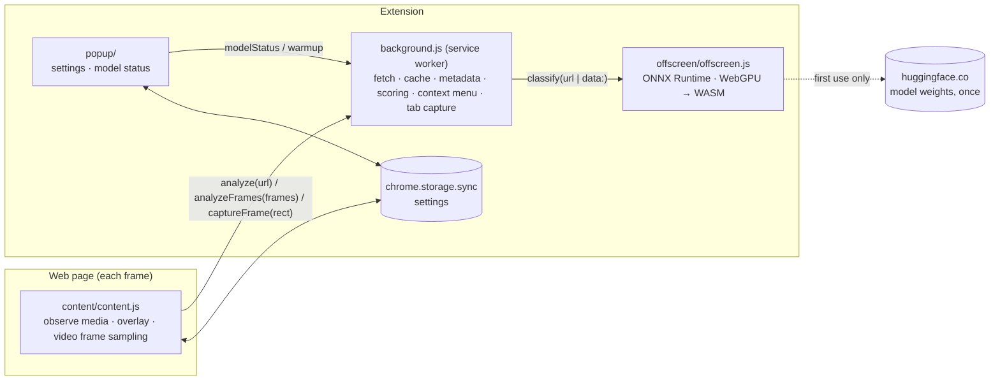
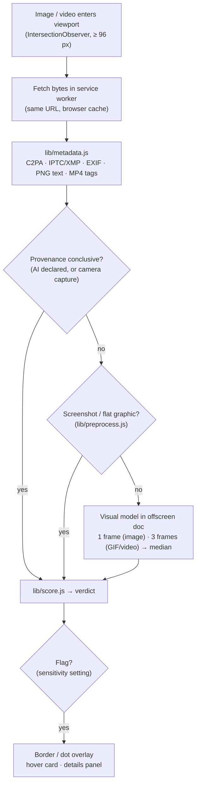

# Architecture

Hikaku is a Manifest V3 extension that runs in four contexts. Everything is analyzed locally.

## Detection pipeline

Cheap checks that can settle the question run first. The model only runs if they can't.

### Scoring (`lib/score.js`)

Every finding becomes a **signal** `{source, kind, strength, label, detail}`, and independent signals are combined with a noisy-OR. A few rules keep false positives down:

- Generator names only count when they appear in *tool* fields (EXIF Software, XMP CreatorTool and similar), never in free-text descriptions or artist names.
- The visual model on its own can reach **Likely AI** (P ≥ 0.90) at most. **AI-generated** needs provenance.
- **Strict** sensitivity only flags verdicts backed by provenance.

### Why an offscreen document?

MV3 service workers get suspended after about 30 s idle, and they can't load ONNX Runtime's WASM factory because dynamic `import()` isn't allowed there. An offscreen document sticks around for the whole browser session, so the model loads once. `lib/classifier.js` creates the document on demand and retries messages while it's still starting up.

### Overlay (`content/content.js`)

- It lives in a closed shadow root on one fixed-position host. Page CSS can't break it, and it can't break the page.
- The frames never take pointer events, so the page stays clickable. Only the small tag/dot handle does.
- Hover is detected geometrically (is the pointer inside a flagged rect?), which keeps working when a site lays a transparent overlay over its images.
- Positions update on scroll and resize through `requestAnimationFrame`, plus a 600 ms ticker to catch layout shifts.

### Video

1. Direct files (`http(s):`) get a container metadata check first: range requests for the head and the tail, 3 MB each.
2. If that doesn't settle it, we sample up to 3 frames while the video is visible, at least 1.5 s apart in media time, and skip near-black ones.
3. Frames normally come from `canvas.drawImage(video)`. When the canvas is tainted (cross-origin video without CORS), the service worker captures the visible tab, rate-limited to about 1.5 per second, and crops out the video's rectangle.

## Messages

| Message | From → To | Purpose |
|---|---|---|
| `analyze {url, kind}` | content/popup → SW | Full analysis of an image or video URL (cached per session) |
| `analyzeFrames {url, frames[]}` | content → SW | Score sampled video frames, merge with container metadata |
| `captureFrame {rect, dpr}` | content → SW | Screenshot fallback for tainted video |
| `showDetails {url, result \| loading}` | SW → content | Open the panel (context menu) |
| `stats` | popup → content | Per-page counts |
| `modelStatus`, `modelWarmup` | popup → SW | Model download/load state |
| `{target:'offscreen', type:'classify' \| 'status' \| 'warmup'}` | SW → offscreen | Model inference |

## Security notes

- CSP: `script-src 'self' 'wasm-unsafe-eval'`. No remote code, and ONNX Runtime is vendored.
- Extension pages are cross-origin isolated (COOP/COEP) so WASM can use threads.
- The overlay DOM is built from `textContent` and attributes only. Page data never goes through `innerHTML`.
- Model weights are pinned to a Hugging Face commit in `lib/model-config.js`.
